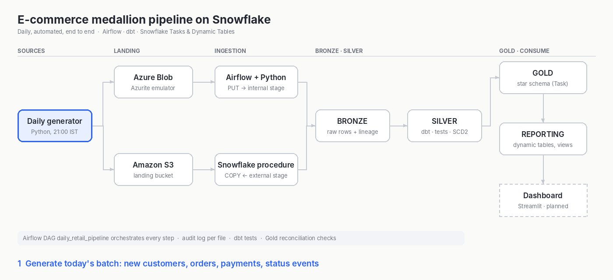
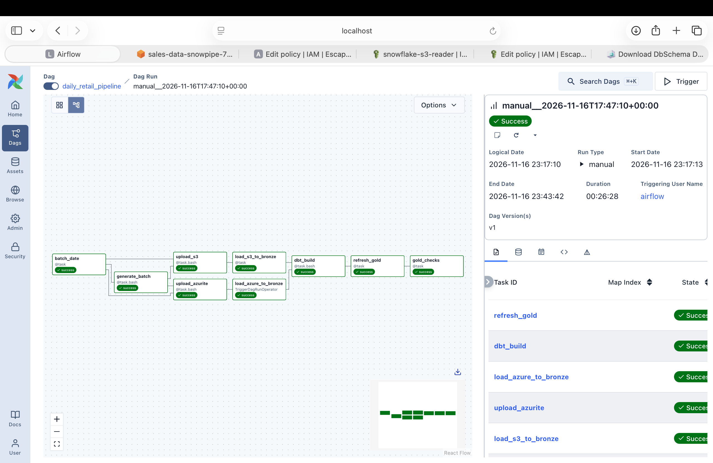
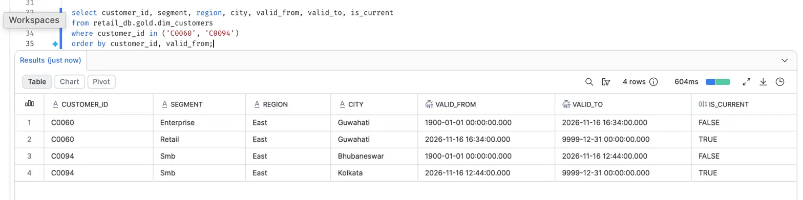
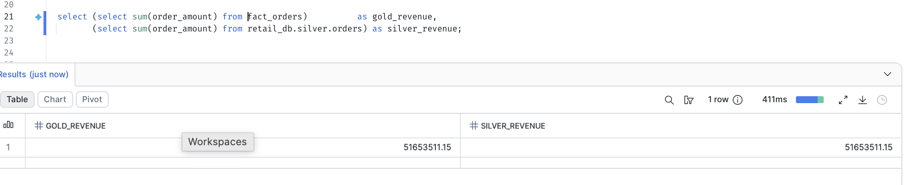
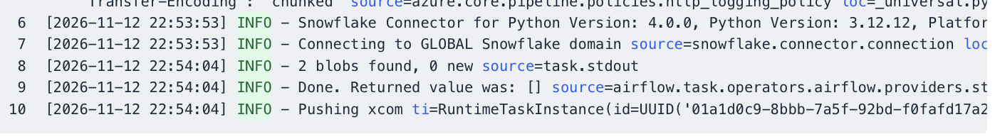

# E-commerce Analytics Platform on Snowflake

An end-to-end, automated **medallion pipeline** (Bronze → Silver → Gold) for an e-commerce business.
Every evening a new batch of orders, payments and status events lands in two different storage systems,
is ingested two different ways, transformed and tested with dbt, modelled into a star schema with
**SCD Type 2** customer history, and reconciled before anyone reads it.



**Highlights**

- Two contrasting ingestion patterns into one Bronze contract: **Airflow-orchestrated** (Azure Blob) and **Snowflake-native** (S3)
- **Idempotent at every step**: reruns never duplicate data, proven by deliberately breaking it
- **Incremental dbt Silver** that merges only real changes, with tests and Bronze-to-Silver reconciliation
- **SCD Type 2** customer dimension (dbt snapshot) and **point-in-time** fact joins
- Gold rebuilt by a **Snowflake Task**, reporting layer of **Dynamic Tables** and KPI views
- **Least-privilege roles**, key-pair service authentication, resource monitor on a trial budget
- A **daily data generator** keeps the pipeline running on fresh, realistic data, including deliberate data-quality issues

---

## Architecture

| Layer | What happens | Built with |
|---|---|---|
| **Sources** | A generator writes each day's batch as dated, immutable CSV files | Python |
| **Landing** | Payments and status events go to Azure Blob; customers, orders and items go to S3 | Azurite, Amazon S3 |
| **Ingestion (Azure)** | Airflow downloads new blobs, `PUT`s them to an internal stage, runs `COPY INTO` | Airflow, Python, Snowflake |
| **Ingestion (S3)** | A Snowflake procedure runs `COPY INTO` from an external stage | Snowflake stored procedure |
| **Bronze** | Every row exactly as received, all `VARCHAR`, plus file and load lineage | Snowflake |
| **Silver** | Typed, deduplicated, one current row per entity; customer history snapshotted | dbt (incremental merge, snapshot, tests) |
| **Gold** | Star schema with SCD2 customers and point-in-time joins | Snowflake Task + procedure |
| **Reporting** | Daily revenue, customer summary, payment and fulfillment health, executive KPIs | Dynamic Tables, views |
| **Dashboard** | Reads Gold only, through a read-only role | Streamlit *(planned)* |

The whole chain runs as one Airflow DAG, `daily_retail_pipeline`, at 21:00 IST:

```
batch_date → generate_batch ─┬─ upload_azurite → load_azure_to_bronze ─┐
                             └─ upload_s3      → load_s3_to_bronze    ─┴→ dbt_build → refresh_gold → gold_checks
```

`refresh_gold` starts the Snowflake task and polls it until it succeeds; `gold_checks` fails the run if
Gold does not reconcile with Silver, so bad data never looks like a green run.

---

## How the design evolved


The first sketch, before any constraints were known. What changed and why:

- **Ingestion paths swapped.** Azure became the Airflow-orchestrated path because Azure Blob is emulated
  with Azurite, which Snowflake can't reach; S3 became the Snowflake-native path.
- **S3 is schedule-driven, not event-driven.** The bucket's region differs from the Snowflake account's,
  so Snowpipe auto-ingest wasn't possible.
- **One Gold mechanism instead of "Streams/Tasks or Dynamic Tables".** A Task rebuilds the star schema;
  Dynamic Tables handle only the aggregates on top.
- **Bronze and Silver relabelled.** The sources are separate entity files, so neither layer is
  denormalized; Silver is one typed, deduplicated row per entity, plus an SCD2 snapshot of customers.
- **Consumers narrowed** to a Streamlit dashboard (planned); BI tools stay on the roadmap.
- **Added during the build:** a daily data generator, Airflow orchestration end to end, audit logging,
  reconciliation checks, and least-privilege roles.

## Data model

Kimball star schema in `RETAIL_DB.GOLD`.

| Table | Grain | Notes |
|---|---|---|
| `dim_customers` | One row per customer **version** | SCD2 view over the dbt snapshot; `customer_sk`, `valid_from`, `valid_to`, `is_current` |
| `dim_products` | One row per product | Derived from order items (no product source) |
| `dim_date` | One row per day, 2000–2050 | Static calendar |
| `fact_orders` | One row per order | Linked to the customer version valid at `order_ts` |
| `fact_order_items` | One row per order item | Carries its own customer and date keys |
| `fact_payments` | One row per payment **attempt** | Retries and failures kept |
| `fact_order_status_events` | One row per status event | Full order lifecycle |

- Schema diagram: [`docs/gold_full_model.dbml`](docs/gold_full_model.dbml) (paste into [dbdiagram.io](https://dbdiagram.io))
- Lineage of the reporting layer: [`docs/gold_lineage.mmd`](docs/gold_lineage.mmd)

---

## Key design decisions

**Bronze is all `VARCHAR`.** A typed Bronze would make `COPY` drop a row with a bad value, quietly. Storing
everything as text means no row is ever lost; Silver casts with `TRY_` functions, tests flag the bad values,
and lineage columns trace each one to its exact file and row.

**Source files are immutable and dated** (`orders/orders_2026-11-16.csv`). Changes arrive as new files, so
Bronze accumulates the full history of every version the source ever sent.

**Idempotency, and how it was tested.** The Azure path skips files already logged in
`AUDIT.FILE_INGESTION_LOG`; the S3 path relies on Snowflake's `COPY` load history. To test the Azure path's
"second guard", the audit rows were deleted and the DAG rerun: the data **duplicated**, because each run
re-`PUT`s the file and creates a new staged object that `COPY` doesn't recognise. Conclusion: on that path
the audit log is the only guard. The duplicates were removed surgically using `LOAD_ID`.

**Silver merges only real changes.** Each incremental run reads only newly arrived Bronze rows, keeps the
newest version per key, and merges a row only if it's new or strictly newer than what Silver holds. Late,
older versions can't overwrite newer data, and unchanged rows are never "updated". `full_refresh: false`
protects the tables from accidental rebuilds.

**SCD2 with a point-in-time join.** A dbt snapshot keeps customer history; `dim_customers` exposes it with
surrogate keys. Facts find the version where `valid_from <= order_ts < valid_to`. The first version of each
customer is valid from `1900-01-01`, so orders placed before a customer's first recorded update still match.

**Gold as a task, triggered by the pipeline.** A stored procedure rebuilds Gold in dependency order
(`fact_orders` before `fact_order_items`). Its task has no schedule: Airflow runs it with `EXECUTE TASK`
right after dbt, so Gold can never build on stale Silver.

**Dynamic Tables for heavy aggregates, views for the rest.** Aggregates read often are stored and refreshed
automatically within a one-hour target lag; lighter or derived logic stays in views. Date-dependent columns
(days since last order) live in views, since `CURRENT_DATE` can't be refreshed incrementally.

**Least privilege, for reads too.**

| Role | Bronze | Silver | Gold | Audit |
|---|---|---|---|---|
| `LOADER_ROLE` | read + write | — | — | read + write |
| `TRANSFORMER_ROLE` | read | owns | owns | read + write |
| `REPORTER_ROLE` | — | — | read | — |

Pipeline services authenticate with **key pairs**, never passwords. Tasks run as their owner, so every Gold
object, the procedure and the task are owned by `TRANSFORMER_ROLE`.

---

## Scope decisions and constraints

These were deliberate choices, documented rather than hidden:

- **Azure Blob is emulated with Azurite.** No Microsoft account was available. The ingestion code is
  identical against real Azure; only the connection string changes.
- **S3 uses read-only access keys instead of a storage integration.** The intended design (an IAM role
  assumed by Snowflake, [`04_s3_integration_stage.sql`](snowflake/s3_ingestion/s3_stage_integration.sql))
  was blocked by organization-level policies on the AWS account. The fallback user can only list and read
  one bucket, its key lives only in Snowflake's encrypted stage definition, and it is deleted at project end.
- **S3 loading is schedule-driven, not Snowpipe auto-ingest.** The bucket's region differs from the
  Snowflake account's, and S3 event notifications only reach same-region queues. With a same-region bucket,
  the same stage supports auto-ingest.
- **Separate S3 identities:** Snowflake reads with one IAM user; the generator writes with another
  (`PutObject` only), so neither can do the other's job.
- **30-day Snowflake trial:** XS warehouse, 60-second auto-suspend, a 60-credit monthly resource monitor.

---

## Data quality findings

Found by tests and lineage, not by eye:

- **8 of 200 customers arrive without an email** (source rows 11, 30, 55, 86, 113, 183, 194, 200). Kept in
  Silver and flagged by a warn-level test; whether that's acceptable is a business decision.
- **Status events and order timestamps disagree**: some `CREATED` events are recorded after the order's
  `order_ts`. A warn-level test documents it.
- **Orders stuck in `PROCESSING`** for months, visible in the fulfillment view.
- **Duplicate payment rows** collapse to one in Silver.
- `initcap` on segment turns the acronym `SMB` into `Smb` — cosmetic, noted rather than rewritten.

Reconciliation after every run: Gold revenue and order counts equal Silver's exactly; every order resolves to
a customer version, a date and its products.

---

## Repository layout

```
├── airflow/dags/            daily_retail_pipeline.py, azure_to_bronze.py
├── datasets/raw/            original dataset (batches/ is generated and gitignored)
├── dbt/                     Silver models, customer snapshot, tests
├── docker/                  Dockerfile, docker-compose.yaml, airflow.env.example
├── docs/                    data model (DBML), lineage (Mermaid), key-pair guide, images
├── ingestion/
│   ├── generator/           daily batch generator
│   ├── azure/               Azurite upload
│   └── s3/                  S3 upload
├── aws/iam/                 IAM policy templates (placeholders only)
└── snowflake/
    ├── setup/               01 account setup, 00 ownership fixes
    ├── audit/               02 audit tables
    ├── bronze/              03 file format, stages, Bronze tables
    ├── s3_ingestion/        04 integration (intended), 04b access-key stage (used), 05 load procedure
    └── gold/                06 dims, 07 facts, 09 reporting, 10 refresh task, 11 checks
```

---

## Running it

**Prerequisites:** Snowflake account, AWS account, Docker Desktop, Python 3.12.

1. **Snowflake foundation:** run `snowflake/setup/01_account_setup.sql`, then `audit/02`, `bronze/03`.
   Create the service user's key pair with [`docs/snowflake_keypair_setup.md`](docs/snowflake_keypair_setup.md).
2. **S3:** create the bucket and the two IAM users from `aws/iam/`, then run `s3_ingestion/04b` and `05`.
3. **Local environment:** `python -m venv .venv && source .venv/bin/activate && pip install -r requirements.txt`;
   copy `.env.example` to `.env` and fill it in.
4. **Azurite:** `docker run -d -p 10000:10000 --name azurite -v azurite_data:/data mcr.microsoft.com/azure-storage/azurite azurite-blob --blobHost 0.0.0.0 --location /data --skipApiVersionCheck`
5. **dbt:** copy `dbt/profiles.yml.example` to `~/.dbt/profiles.yml`, then `cd dbt && dbt deps && dbt build`.
6. **Gold:** run `snowflake/gold/06` → `07` → `09` → `10`, then `11_checks.sql`.
7. **Airflow:** in `docker/`, copy `airflow.env.example` to `airflow.env`, adjust the host paths in
   `docker-compose.yaml`, then `docker compose build airflow-init && docker compose up -d`.
   Unpause `daily_retail_pipeline` and `azure_to_bronze` at http://localhost:8080.

---

## Roadmap

- Streamlit dashboard on Gold (KPI tiles, trends, retention, payment and fulfillment health)
- Azurite as a docker-compose service, so it starts with Airflow
- Facts as stream-driven `MERGE`s instead of rebuilds
- Snowpipe auto-ingest with a same-region bucket
- CI: SQL linting and `dbt build` on pull requests

---

## Screenshots

<!-- Add after capturing: crop out AWS account IDs and email addresses -->




